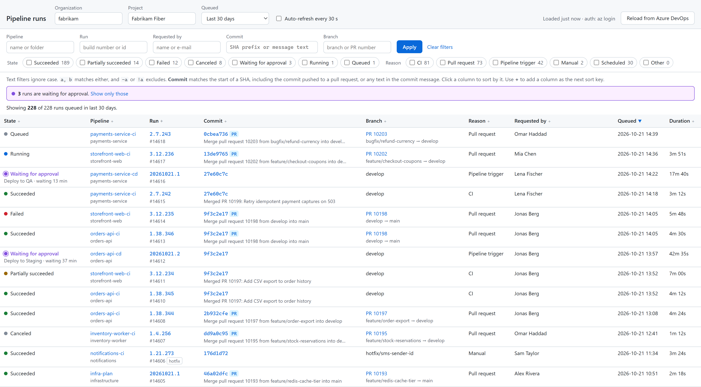
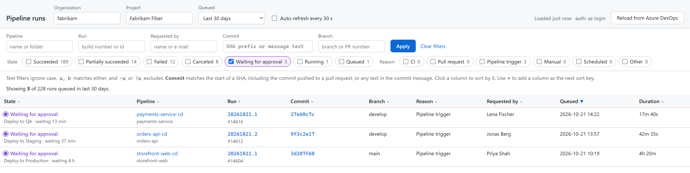
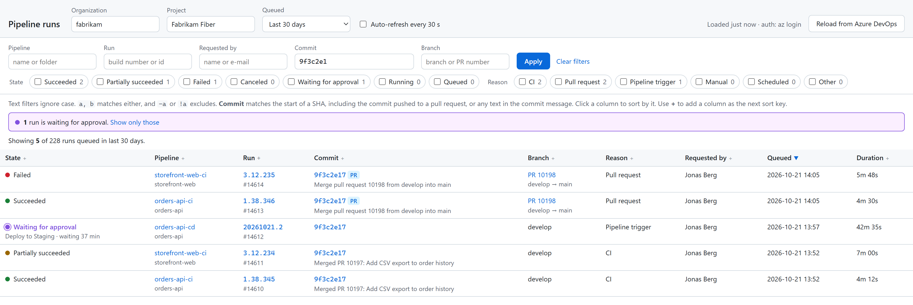
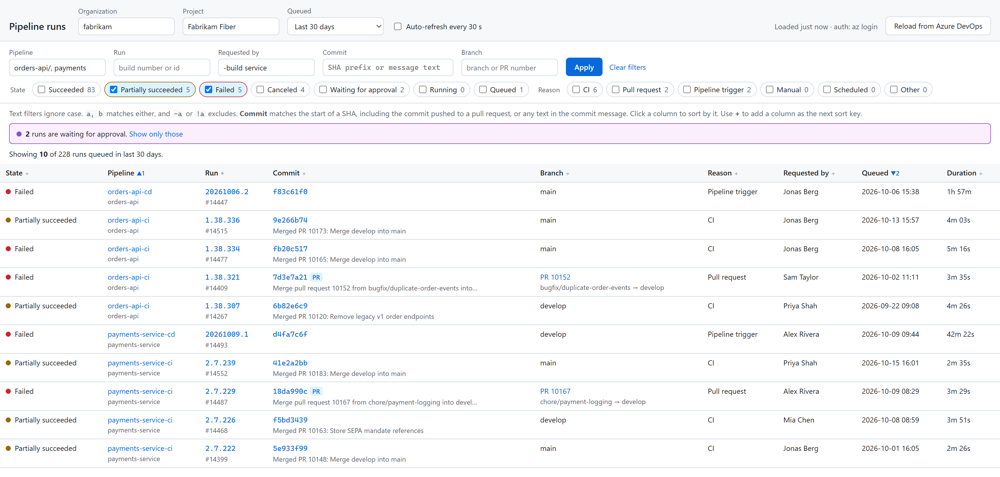

# one-azdo-pipeline-filter

A local page that lists Azure DevOps pipeline runs, like the portal's
*Pipelines → Runs* view, with more filters. The main addition is a **commit**
filter.

It is plain Python (standard library only, Python 3.11+) and plain HTML. There
is no JavaScript and nothing to install.

<picture>
  <source media="(prefers-color-scheme: dark)" srcset="docs/screenshots/overview-dark.png">
  
</picture>

The screenshots show a made-up project. See
[`docs/screenshots/make_screenshots.py`](docs/screenshots/make_screenshots.py).

## Run it

```powershell
python app.py --open
```

The page opens at <http://127.0.0.1:8765/>.

Organization and project default to what `az devops configure --defaults` has
stored. Override them on the command line or in the page header:

```powershell
python app.py --org fabrikam --project "Fabrikam Fiber" --port 8765
```

| Option | Default | Meaning |
|---|---|---|
| `--org` | az devops default | Organization name or URL |
| `--project` | az devops default | Project name |
| `--port` | 8765 | Port on 127.0.0.1 |
| `--max-age` | 300 | Seconds before loaded runs are fetched again |
| `--open` | off | Open the page in your browser |

## Authentication

- If `AZDO_PAT` or `AZURE_DEVOPS_EXT_PAT` is set, that PAT is used. It needs
  the **Build (Read)** and **Code (Read)** scopes. **Project and Team (Read)**
  is optional; it only fills the project suggestions.
- Otherwise the server runs `az account get-access-token` for Azure DevOps with
  your current `az login`. It refreshes the token shortly before it expires.

The token stays inside the server process and is never sent to the browser. The
server listens on 127.0.0.1 only. It answers only requests addressed to
`127.0.0.1:<port>` or `localhost:<port>`, so another web page cannot use it to
read your Azure DevOps data. It makes only read-only GET requests to
`dev.azure.com`.

## Filters

| Filter | Matches |
|---|---|
| Pipeline | Pipeline name or folder, e.g. `orders` or `orders-api/` |
| Run | Build number (`1.37.1`) or build id (`12363`) |
| Requested by | Display name or e-mail of the person the run was requested for |
| Commit | The start of a commit SHA, or any text in the commit message |
| Branch | Branch name, PR number (`PR 10206`), or a PR's source or target branch |
| State | Succeeded, partially succeeded, failed, canceled, **waiting for approval**, running, queued |
| Reason | CI, pull request, pipeline trigger, manual, scheduled, other |
| Queued | Last 24 hours, 7, 30 or 90 days, or all retained runs |

All text filters use the same syntax:

- Matching ignores case.
- `a, b` matches either term.
- `-a` or `!a` excludes a term.
- Example for Requested by: `-build service`.

Press **Enter** in a text field, or click **Apply** after ticking checkboxes.
The number next to each checkbox is how many runs it would show with the other
filters unchanged.

### Waiting for approval

A run held at an environment approval is still "in progress" in the builds
API, so the portal's run list shows it as running. On every load, this app also
reads the project's pending approvals, in one call, and marks their runs
**Waiting for approval**. For each such run:

- The state cell shows the stage that is waiting, e.g. *Deploy to Production*, and
  how long it has waited.
- Hovering over the state cell lists the approvers who haven't responded yet and
  how many approvals are needed.
- The label links to the run in Azure DevOps, where the Review button is.

A banner above the table counts the waiting runs and links to a view of only
those.



The stage names come from each run's timeline. An approval always belongs to
the same stage, so these lookups are stored in
`.cache/approval-stages.json` and are not repeated.

If the approvals can't be read, for example because a PAT lacks access, the
page says so, and those runs show as Running.

### Commit filter and pull requests

For a pull-request run, Azure DevOps builds a temporary merge commit, and the
portal shows that merge commit's SHA. The SHA you actually pushed never shows
up. This app looks up each PR run's merge commit and reads its second parent,
which is the commit that was pushed. The Commit column shows that commit with a
**PR** badge.

A short SHA from `git log` therefore finds these runs:

- The CI runs of that commit, e.g. every `*-ci` pipeline a monorepo merge
  triggers.
- The PR validation runs of that commit.

On a row, hover over the commit and click **all runs** to see every run of that
commit.



The lookups are stored in `.cache/merge-commits.json`, so each merge commit is
fetched only once. Commits never change, so the stored entries stay valid. The
first load of a project with many PR runs takes a few seconds longer.

## Sorting

- Click a column header to sort by that column. Click it again to reverse the
  order.
- Click the small **+** next to a header to add that column as the next sort
  key. For example, sort by Pipeline, then **+** on Queued.
- A numbered arrow (`▼2`) marks a secondary key. Click it to reverse that key.



## Refreshing

Loaded runs are kept for `--max-age` seconds (default 5 minutes), so changing
filters is instant. **Reload from Azure DevOps** fetches the runs again
straight away. **Auto-refresh every 30 s** reloads the page and its data every
30 seconds. This is useful while runs are in progress, but it also interrupts
typing, so turn it off while editing filters.

Every filter and the sort order are part of the URL, so a view can be
bookmarked or shared with someone who runs the app too.

## Files

| File | Contents |
|---|---|
| `app.py` | Entry point and HTTP server |
| `ado.py` | Azure DevOps defaults, authentication and REST calls |
| `store.py` | Cache of loaded runs, the PR commit lookup, and pending approvals |
| `runs.py` | Normalising, filtering, sorting and URL state (no I/O) |
| `page.py`, `templates/index.html`, `static/style.css` | The page |
| `tests/` | Unit and HTTP tests, which never call Azure DevOps |
| `docs/screenshots/` | The README screenshots, and the script that makes them from made-up data (needs Chrome or Edge, and Pillow) |

Run the tests:

```powershell
python -m unittest
```
